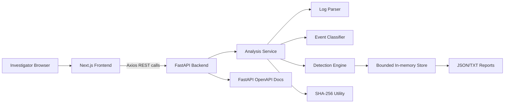
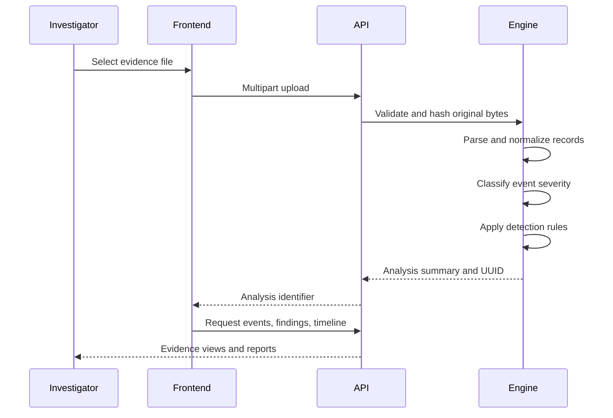

# LogGuard — System Log Forensic Analyzer


LogGuard is a local-first web application for **Cyber Security and Digital Forensics (CSDF)**. It helps an investigator upload system logs, preserve their original hash, normalize records, identify suspicious activity, reconstruct a forensic timeline, and export evidence-backed reports.

The project is designed as a final-year computer engineering mini-project demonstration. It uses transparent rule-based detection rather than machine learning, does not require a database or paid cloud service, and keeps uploaded log content within the local FastAPI backend.

> **Forensic disclaimer:** LogGuard is a triage and educational tool. A finding does not prove malicious intent, attribution, or a legal conclusion. Only analyze logs that you are authorized to access.

---

## Problem statement

System logs contain valuable evidence about authentication attempts, user activity, service failures, administrative actions, and system errors. Manually reviewing these records is time-consuming and makes it difficult to correlate repeated activity across timestamps, accounts, source IP addresses, and event categories.

LogGuard solves this problem by providing one local interface for:

1. Uploading supported log evidence.
2. Extracting useful forensic fields.
3. Detecting repeated and correlated suspicious activity.
4. Reconstructing a chronological timeline.
5. Preserving malformed and incomplete records for review.
6. Verifying evidence integrity with SHA-256.
7. Generating structured JSON and TXT reports.

---

## Objectives

- Build a full-stack forensic analysis application.
- Parse Linux authentication and system logs.
- Parse Windows Event Viewer CSV and JSON exports.
- Normalize different records into a common event model.
- Detect repeated failed login attempts.
- Detect account targeting and success-after-failure patterns.
- Identify privileged activity and repeated service failures.
- Classify event and finding severity.
- Provide searchable events and timeline views.
- Calculate and verify SHA-256 file hashes.
- Maintain temporary, bounded analysis history.
- Demonstrate secure local processing with a clear architecture.

---

## Features

### Evidence intake

- Drag-and-drop upload interface.
- Browse-file upload support.
- Supported extensions: `.log`, `.txt`, `.csv`, `.json`.
- Maximum upload size: 10 MB.
- Empty-file and unsupported-file validation.
- Original bytes are hashed before parsing.

### Forensic analysis

- Linux syslog and SSH authentication parsing.
- Windows Event Viewer CSV/JSON parsing.
- Generic timestamp extraction.
- Event normalization.
- Event severity classification.
- Suspicious-activity detection.
- Chronological event timeline.
- Data-quality findings for malformed records and missing timestamps.

### Investigation interface

- Evidence-led dashboard.
- Statistics based on actual backend data.
- Searchable event table.
- Severity badges.
- Findings with explanations and related evidence IDs.
- SHA-256 verification form.
- JSON and TXT report download.
- Temporary analysis history.
- Clear-history action.
- Responsive layout for smaller screens.

---

## Architecture



### Component responsibilities

| Component | Responsibility |
|---|---|
| Next.js frontend | Navigation, upload, dashboard, event review, timeline, history, reports |
| Axios client | Centralized REST API calls and error handling |
| FastAPI | Upload validation, API routing, CORS, response serialization |
| Log parser | Format detection, field extraction, timestamp normalization |
| Event classifier | Individual event category and severity reasoning |
| Detection engine | Correlation rules and suspicious findings |
| Analysis service | Coordinates parsing, hashing, statistics, findings, and storage |
| History service | UUID records, TTL cleanup, maximum history size |
| Report generator | JSON and TXT forensic exports |

No permanent database is used in the initial implementation. The browser does not store log content. Analysis history is lost when the backend restarts or records expire.

---

## Project structure

```text
LogGuard/
├── backend/
│   ├── api/
│   │   └── routes/
│   │       ├── analysis.py
│   │       ├── health.py
│   │       └── reports.py
│   ├── forensic/
│   │   ├── detection_engine.py
│   │   ├── event_classifier.py
│   │   ├── hash_utils.py
│   │   ├── log_parser.py
│   │   ├── report_generator.py
│   │   └── timeline.py
│   ├── models/
│   │   └── schemas.py
│   ├── services/
│   │   ├── analysis_service.py
│   │   └── history_service.py
│   ├── sample_logs/
│   │   ├── sample_auth.log
│   │   ├── sample_system.log
│   │   └── sample_windows.csv
│   ├── tests/
│   │   └── test_core.py
│   ├── config.py
│   ├── main.py
│   └── requirements.txt
├── frontend/
│   ├── app/
│   │   ├── about/
│   │   ├── analysis/[id]/
│   │   ├── history/
│   │   ├── upload/
│   │   ├── globals.css
│   │   ├── layout.tsx
│   │   └── page.tsx
│   ├── components/
│   ├── lib/
│   ├── package.json
│   └── .env.example
├── docs/
│   ├── architecture.md
│   ├── test_cases.md
│   └── workflow.md
├── public/
│   ├── dashboard-page.png
│   ├── upload-log-page.png
│   ├── Analysis-Results-Page.png
│   ├── analysis-history-page.png
│   └── SHA-256 Integrity Verification.png
├── report.md
└── README.md
```

---

## Technology stack

### Frontend

- Next.js App Router
- React
- TypeScript
- Tailwind CSS
- Axios
- Lucide React
- Responsive CSS components

### Backend

- Python 3.11+
- FastAPI
- Uvicorn
- Pydantic
- `python-multipart`
- Python standard library modules:
  - `re`
  - `datetime`
  - `collections`
  - `hashlib`
  - `json`
  - `csv`
  - `logging`

### Development and testing

- Visual Studio Code
- Windows PowerShell
- MinGW/Node-compatible local development environment
- pytest
- FastAPI TestClient
- Next.js build tooling

---

## Supported formats

### Linux authentication and system logs

Example:

```text
Oct 15 10:15:02 workstation sshd[1234]: Failed password for user1 from 192.168.1.25 port 52210 ssh2
```

The parser extracts:

- Timestamp
- Hostname
- Process name
- Process ID
- Username
- Source IP
- Message
- Category
- Parsed status

Recognized SSH authentication indicators include:

- `Failed password`
- `Accepted password`
- `Failed publickey`
- `Accepted publickey`
- `Invalid user`
- Authentication/session messages

### Windows Event Viewer exports

CSV and JSON records can include:

- Event ID
- Timestamp
- Computer name
- Provider
- Event level
- Username
- Source IP
- Event message

Recognized security event IDs:

| Event ID | Meaning |
|---|---|
| 4624 | Successful logon |
| 4625 | Failed logon |
| 4634 | Logoff |
| 4672 | Special privileges assigned |
| 4740 | User account locked out |

LogGuard does **not** claim to parse binary `.evtx` files. Export Event Viewer data to CSV or JSON first.

### Generic text records

ISO-style timestamps are detected when available. Unparsed records are retained with their original line and marked as data-quality observations.

---

## Normalized event model

All supported records are converted into a common schema:

```json
{
  "event_id": "uuid",
  "timestamp": "2026-10-15T10:15:02",
  "original_timestamp": "Oct 15 10:15:02",
  "hostname": "workstation",
  "process": "sshd",
  "process_id": "1234",
  "username": "user1",
  "source_ip": "192.168.1.25",
  "category": "authentication",
  "severity": "low",
  "severity_reason": "A single authentication failure is a low-severity observation.",
  "message": "Failed password for user1 from 192.168.1.25",
  "line_number": 10,
  "parsed": true,
  "raw": "original record"
}
```

Missing information is not invented. A syslog record without a year uses the backend server year as a documented inference rule.

---

## Analysis workflow



1. Select a local log file.
2. Validate extension and file size.
3. Calculate SHA-256 from the original upload.
4. Parse the file according to its extension.
5. Normalize records into the common event schema.
6. Classify event categories and individual severity.
7. Apply correlation and detection rules.
8. Store the analysis temporarily under a UUID.
9. Display actual statistics, events, findings, and timeline.
10. Verify a reference hash or download a report.

---

## Detection rules

Default configuration:

| Configuration | Default |
|---|---:|
| Failed-login threshold | 5 attempts |
| Detection window | 5 minutes |
| Service-failure threshold | 3 records |
| Expected operating hours | 07:00–19:00 |
| Maximum upload size | 10 MB |
| Maximum stored analyses | 20 |
| Analysis retention | 1 hour |

### Repeated failed login attempts

Detects the configured number of failed authentication events from one source IP within the configured time window.

### Multiple failures against one account

Groups failed authentication records by username and detects repeated targeting of the same account.

### Successful login after repeated failures

Correlates a successful login with a source IP or username that previously generated repeated failures.

### Privileged account activity

Identifies `sudo`, privilege-related messages, and Windows Event ID `4672`. The result is an auditable administrative observation, not automatic proof of malicious behavior.

### Repeated service failures

Detects repeated service failure, startup failure, or service error records.

### Unusual activity hours

Identifies authentication events outside the configured operating hours.

### Malformed records

Identifies records that could not be parsed or have missing timestamps. These are primarily data-quality findings.

Every finding includes a rule name, severity, description, explanation, time range, source/account context where available, and related event IDs.

---

## Severity model

Event severity and aggregated finding severity are separate concepts:

| Severity | Typical interpretation |
|---|---|
| Critical | Reserved for clearly defined high-impact evidence |
| High | Strong aggregate pattern such as repeated authentication failures |
| Medium | Privileged activity, repeated service failures, or unusual hours |
| Low | Individual failure, operational error, or data-quality observation |
| Informational | Normal activity with no suspicious indicator |

The application does not label legitimate administrative activity as malicious automatically.

---

## Digital evidence integrity

LogGuard calculates SHA-256 from the original uploaded bytes before parsing. The digest is:

- Displayed on the analysis page.
- Included in JSON and TXT reports.
- Available for comparison against an optional reference hash.

The verification response is either:

- **Hash Match**
- **Hash Mismatch**

A match demonstrates byte-for-byte equality with the supplied digest. It does not prove source authenticity or establish a complete chain of custody.

---

## REST API

Backend base URL:

```text
http://127.0.0.1:8000
```

| Method | Endpoint | Purpose |
|---|---|---|
| GET | `/api/health` | Check service status |
| POST | `/api/analyze` | Upload and analyze a file |
| GET | `/api/analysis/{analysis_id}` | Retrieve summary |
| GET | `/api/analysis/{analysis_id}/events` | Retrieve paginated/searchable events |
| GET | `/api/analysis/{analysis_id}/timeline` | Retrieve chronological records |
| GET | `/api/analysis/{analysis_id}/findings` | Retrieve suspicious findings |
| GET | `/api/history` | Retrieve temporary history |
| DELETE | `/api/history` | Clear temporary history |
| GET | `/api/analysis/{analysis_id}/report/json` | Download JSON report |
| GET | `/api/analysis/{analysis_id}/report/txt` | Download TXT report |
| POST | `/api/analysis/{analysis_id}/verify-hash` | Verify reference SHA-256 |

Interactive OpenAPI documentation:

```text
http://127.0.0.1:8000/docs
```

The frontend API client is located at [frontend/lib/api.ts](./frontend/lib/api.ts).

---

## Screenshots

### Dashboard

Live statistics come from the most recent backend analysis. No placeholder values are used.


### Upload logs

The upload page validates supported formats and the 10 MB size limit before analysis.


### Analysis results

The analysis page shows the evidence event table, findings, statistics, reports, and integrity controls.


### SHA-256 integrity verification

Investigators can compare the calculated digest with a trusted reference hash.


### Analysis history

History is temporary and is stored only in the current backend session.


---

## Windows setup

Open two PowerShell terminals in Visual Studio Code.

### Start the backend

```powershell
cd "C:\Users\Vedant\OneDrive\Desktop\VEDANT\lp4\csdf\backend"
python -m venv venv
.\venv\Scripts\Activate.ps1
python -m pip install --upgrade pip
pip install -r requirements.txt
uvicorn main:app --reload --host 127.0.0.1 --port 8000
```

If PowerShell activation is blocked:

```powershell
.\venv\Scripts\python.exe -m pip install -r requirements.txt
.\venv\Scripts\python.exe -m uvicorn main:app --reload --host 127.0.0.1 --port 8000
```

### Start the frontend

Open a second terminal:

```powershell
cd "C:\Users\Vedant\OneDrive\Desktop\VEDANT\lp4\csdf\frontend"
Copy-Item .env.example .env.local
npm install
npm run dev
```

URLs:

```text
Frontend: http://localhost:3000
Backend:  http://127.0.0.1:8000
Swagger:  http://127.0.0.1:8000/docs
```

The frontend environment variable is:

```text
NEXT_PUBLIC_API_URL=http://127.0.0.1:8000
```

---

## Sample datasets

### `sample_auth.log`

Demonstrates:

- Normal SSH login.
- Failed password attempts.
- Five failures from one IP within five minutes.
- Successful login after repeated failures.
- Different usernames.
- Public-key authentication.
- Privileged `sudo` activity.

### `sample_system.log`

Demonstrates:

- Normal system activity.
- Repeated service failures.
- Warning messages.
- A malformed record without a timestamp.

### `sample_windows.csv`

Demonstrates Windows Event IDs:

- 4624
- 4625
- 4634
- 4672
- 4740

Sample data is synthetic and intended for local demonstration only.

---

## Testing and development commands

### Backend tests

```powershell
cd backend
pytest tests -q
```

### Frontend tests

```powershell
cd frontend
npm test
```

### Frontend production build

```powershell
cd frontend
npm run build
```

Backend tests cover parser behavior, detection, upload validation, hashing, reports, and Windows CSV handling. The frontend is designed for API-driven manual demonstration through the provided sample logs.

---

## Security and privacy

Implemented controls include:

- Supported-extension allowlist.
- 10 MB upload bound.
- Empty-file rejection.
- No execution of uploaded content.
- UUID-based analysis identifiers.
- Bounded temporary history.
- Automatic expired-record cleanup.
- Restricted development CORS origin.
- Safe API error messages.
- No unrestricted filesystem paths in API responses.
- No raw HTML rendering for log content.
- No transmission to external APIs.

This is a trusted local educational application, not a hardened multi-user production SOC platform.
