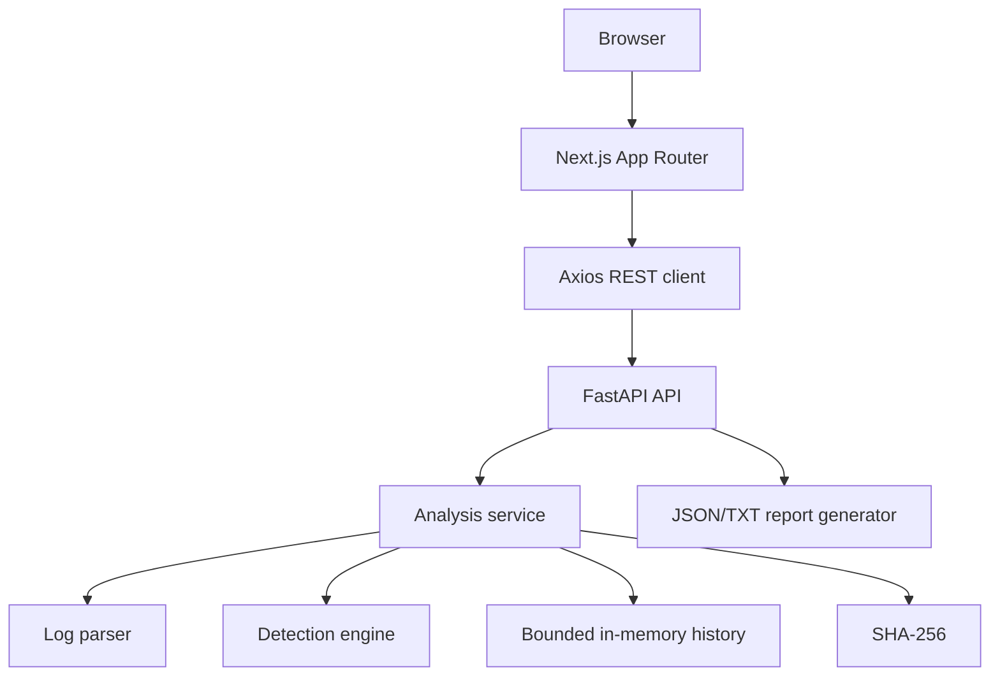

# Architecture

The API is intentionally stateless with respect to permanent storage. The store is protected by a lock and performs TTL and maximum-count cleanup. The frontend receives only normalized JSON and report downloads.
