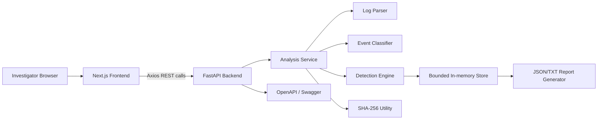
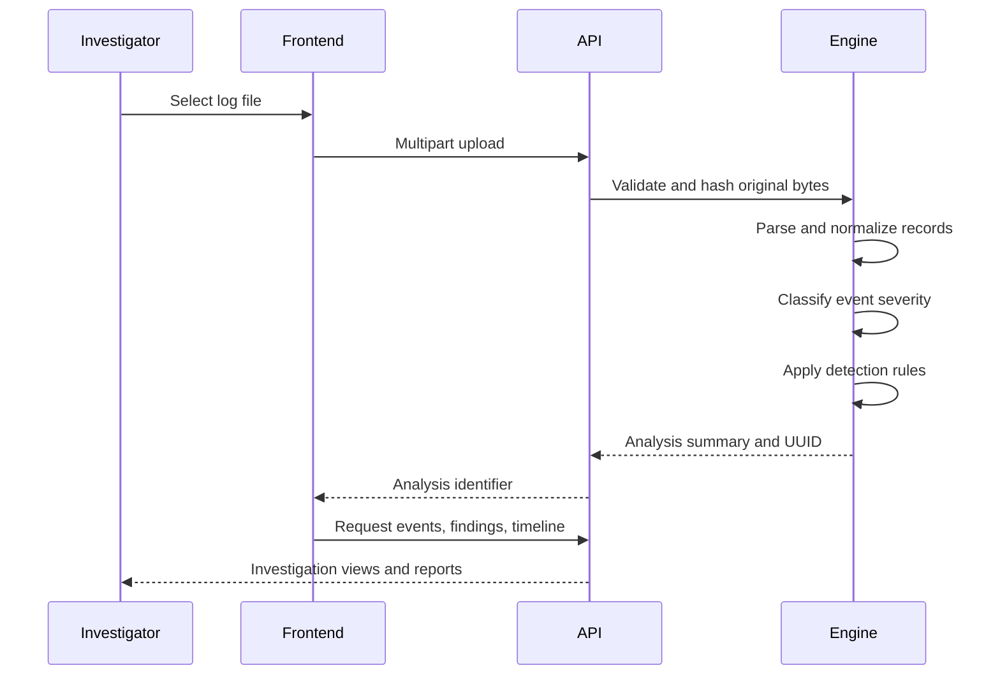

# LogGuard — System Log Forensic Analyzer

**Domain:** Cyber Security and Digital Forensics (CSDF)  
**Project Type:** Full-stack educational mini-project  
**Frontend:** Next.js, TypeScript, Tailwind CSS, Axios, Lucide React  
**Backend:** Python FastAPI, Pydantic  
**Execution Environment:** Windows, Visual Studio Code

---

## Abstract

Computer systems continuously generate authentication, service, and system logs. These records can provide important digital evidence during a cybersecurity investigation, but manually reviewing large log files is slow and can allow repeated suspicious activity to go unnoticed.

LogGuard is a local-first web application for system log forensic analysis. It accepts supported log files, calculates a SHA-256 evidence hash, parses records into a common event structure, classifies event severity, detects suspicious activity using transparent rule-based logic, reconstructs a chronological timeline, and generates forensic reports. The application is designed for a final-year computer engineering demonstration and does not transmit log files to external services.

---

## 1. Problem Statement

System logs contain information about authentication attempts, user activity, service failures, administrative actions, and system errors. A manual investigation must often correlate many records across time, usernames, source IP addresses, and event categories.

The problem addressed by LogGuard is the lack of a simple, explainable, and local tool for:

1. Uploading system log evidence safely.
2. Extracting useful forensic fields automatically.
3. Detecting repeated or correlated suspicious activity.
4. Reconstructing a chronological event timeline.
5. Preserving data-quality observations such as malformed records.
6. Verifying evidence integrity using a cryptographic hash.
7. Producing a structured report for further review.

---

## 2. Objectives

The objectives of LogGuard are:

1. Develop a web-based system log forensic analysis application.
2. Parse Linux authentication and system logs.
3. Parse Windows Event Viewer records exported to CSV or JSON.
4. Normalize records into a common event schema.
5. Detect repeated failed authentication attempts.
6. Detect suspicious activity involving accounts, source IPs, and time windows.
7. Identify repeated service failures and privileged activity.
8. Classify individual events and aggregated findings by severity.
9. Display searchable evidence events and a chronological timeline.
10. Calculate and display the SHA-256 hash of the original upload.
11. Generate JSON and TXT forensic reports.
12. Maintain bounded, temporary analysis history without a database.
13. Provide an understandable architecture suitable for a college viva.

---

## 3. Scope

### Included

- Linux syslog and authentication text parsing.
- Generic text log handling.
- Windows Event Viewer CSV and JSON export parsing.
- Event normalization and timestamp ordering.
- Rule-based suspicious activity detection.
- Severity classification.
- Searchable event review.
- Timeline reconstruction.
- SHA-256 integrity verification.
- Temporary in-memory analysis history.
- JSON and TXT report downloads.
- Local Windows development using FastAPI and Next.js.

### Excluded

- Binary `.evtx` parsing.
- Permanent database storage.
- Cloud log upload or external APIs.
- User authentication and multi-user access control.
- Machine-learning-based anomaly detection.
- Attribution of activity to a person.
- Legal conclusions or formal chain-of-custody certification.

---

## 4. Existing System

In a conventional manual workflow, an investigator opens log files in a text editor or spreadsheet and searches for terms such as `Failed`, `Accepted`, `error`, or `sudo`. This approach has several limitations:

- It is time-consuming for large files.
- Repeated failures may be difficult to correlate.
- Events from different log formats are not normalized.
- Timeline reconstruction is manual.
- Evidence hashes and report generation require separate tools.
- Data-quality issues may be overlooked.

---

## 5. Proposed System

LogGuard provides a single local application for log evidence triage:

1. The investigator selects a supported file in the browser.
2. The file is sent to the local FastAPI backend.
3. The backend validates the extension, size, and empty-file condition.
4. SHA-256 is calculated from the original bytes.
5. The forensic parser normalizes each record.
6. The classifier assigns event category and severity.
7. The detection engine correlates records using configurable rules.
8. The analysis receives a UUID and is stored temporarily in memory.
9. The frontend displays statistics, findings, events, and timeline data.
10. The investigator can verify a reference hash and download reports.

---

## 6. Technology Stack

### Frontend

- Next.js App Router
- React
- TypeScript
- Tailwind CSS
- Axios
- Lucide React icons
- Responsive dashboard components

### Backend

- Python 3.11 or newer
- FastAPI
- Uvicorn
- Pydantic
- `python-multipart`
- Python `re`, `datetime`, `collections`, `hashlib`, `json`, and `csv`

### Testing and validation

- pytest
- FastAPI TestClient
- TypeScript and Next.js build tooling

### Storage

The initial implementation uses a bounded, server-side in-memory store. No database is required. Analysis history is temporary and is lost when the backend restarts or records expire.

---

## 7. System Architecture



The browser is responsible for presentation and interaction. The backend performs all parsing, hashing, detection, storage, and report generation. Log contents are not sent to third-party APIs.

---

## 8. Project Structure

```text
LogGuard/
├── backend/
│   ├── api/
│   │   └── routes/
│   ├── forensic/
│   │   ├── detection_engine.py
│   │   ├── event_classifier.py
│   │   ├── hash_utils.py
│   │   ├── log_parser.py
│   │   ├── report_generator.py
│   │   └── timeline.py
│   ├── models/
│   │   └── schemas.py
│   ├── services/
│   │   ├── analysis_service.py
│   │   └── history_service.py
│   ├── sample_logs/
│   ├── tests/
│   ├── config.py
│   ├── main.py
│   └── requirements.txt
├── frontend/
│   ├── app/
│   │   ├── about/
│   │   ├── analysis/[id]/
│   │   ├── history/
│   │   ├── upload/
│   │   └── page.tsx
│   ├── components/
│   ├── lib/
│   └── package.json
├── docs/
└── report.md
```

---

## 9. Log Analysis Workflow



Malformed records are retained where possible and marked as unparsed or missing-timestamp observations instead of being silently discarded.

---

## 10. Supported Log Formats

### 10.1 Linux authentication and system logs

Example:

```text
Oct 15 10:15:02 workstation sshd[1234]: Failed password for user1 from 192.168.1.25 port 52210 ssh2
```

The parser extracts:

- Timestamp
- Hostname
- Process name
- Process ID
- Username
- Source IP
- Message
- Category
- Parsed status

SSH authentication indicators include failed passwords, accepted passwords, accepted public keys, failed public keys, invalid users, authentication messages, and session open/close records.

### 10.2 Windows exported records

The parser supports CSV and JSON records containing fields such as:

- Event ID
- TimeCreated or timestamp
- Computer name
- Provider
- Username
- Source IP
- Event message

The implementation recognizes relevant security event IDs:

| Event ID | Interpretation |
|---|---|
| 4624 | Successful logon |
| 4625 | Failed logon |
| 4634 | Logoff |
| 4672 | Special privileges assigned |
| 4740 | Account locked out |

### 10.3 Generic records

Records with ISO-style timestamps are retained and normalized where possible. Records that cannot be parsed remain available with their original content and a data-quality status.

---

## 11. Normalized Event Model

Each event follows a common structure:

```json
{
  "event_id": "uuid",
  "timestamp": "2026-10-15T10:15:02",
  "original_timestamp": "Oct 15 10:15:02",
  "hostname": "workstation",
  "process": "sshd",
  "process_id": "1234",
  "username": "user1",
  "source_ip": "192.168.1.25",
  "category": "authentication",
  "severity": "low",
  "message": "Failed password for user1 from 192.168.1.25",
  "line_number": 10,
  "parsed": true,
  "raw": "original record"
}
```

Missing values are represented as `null` or an equivalent empty field. The parser does not invent usernames, IP addresses, or timestamps.

For syslog records without a year, the backend uses the current server year as the documented inference rule. This limitation is included in the report output.

---

## 12. Detection Engine

The detection engine is rule-based and explainable. It does not use machine learning.

### Rule 1: Repeated failed login attempts

Detects at least five failed authentication attempts from the same source IP within five minutes by default.

Output includes:

- Source IP
- Attempt count
- First and last timestamps
- Related event IDs
- High severity
- Explanation

### Rule 2: Multiple failures against one account

Groups failed authentication events by username and identifies repeated failures against the same account.

### Rule 3: Successful login after repeated failures

Correlates a successful authentication with a source IP or account that previously generated repeated failed attempts.

### Rule 4: Privileged account activity

Identifies `sudo`, privilege-related text, and Windows Event ID `4672`. This is classified as auditable administrative activity and is not automatically treated as malicious.

### Rule 5: Repeated service failures

Detects repeated service failure or error messages. The default threshold is three records.

### Rule 6: Unusual activity hours

Identifies authentication events outside the configured expected hours. The default expected window is 07:00 to 19:00.

### Rule 7: Malformed log records

Identifies unparsed records and records with missing timestamps as data-quality findings.

---

## 13. Severity Classification

Event severity and finding severity are treated separately.

| Severity | Typical meaning |
|---|---|
| Critical | Reserved for clearly defined, high-impact evidence |
| High | Strong aggregated suspicious pattern, such as repeated failures |
| Medium | Administrative activity, repeated service failures, or unusual hours |
| Low | Individual failure, operational error, or data-quality observation |
| Informational | Normal activity without a detected suspicious indicator |

A single failed login is not automatically equivalent to a confirmed attack. Aggregated findings provide the investigation context.

---

## 14. Digital Evidence Integrity

LogGuard calculates SHA-256 from the original uploaded bytes before parsing. The hash is displayed in the analysis summary and included in exported reports.

Investigators may submit a reference SHA-256 digest. The system returns:

- **Hash Match**
- **Hash Mismatch**

A matching hash demonstrates byte-for-byte equality with the supplied reference digest. It does not prove that the original source is trustworthy or that the content was collected under a validated chain-of-custody procedure.

---

## 15. Frontend Features

The Next.js frontend provides:

- SOC-style dark sidebar and light workspace
- Dashboard empty state when no analysis exists
- Live statistics from backend analysis results
- Drag-and-drop evidence upload
- Supported-file and size validation
- Analysis loading state
- Searchable event table
- Severity badges
- Suspicious findings panel
- SHA-256 verification form
- JSON and TXT report download links
- Chronological timeline
- Temporary analysis history
- Clear history action
- About page with responsible-use limitations

The dashboard does not use fabricated statistics. A new session displays an empty state until an actual file has been analyzed.

---

## 16. Backend REST API

| Method | Endpoint | Purpose |
|---|---|---|
| GET | `/api/health` | Check backend availability |
| POST | `/api/analyze` | Upload and analyze a log file |
| GET | `/api/analysis/{analysis_id}` | Retrieve analysis summary |
| GET | `/api/analysis/{analysis_id}/events` | Retrieve searchable event records |
| GET | `/api/analysis/{analysis_id}/timeline` | Retrieve chronological events |
| GET | `/api/analysis/{analysis_id}/findings` | Retrieve rule-triggered findings |
| GET | `/api/history` | Retrieve temporary session history |
| DELETE | `/api/history` | Clear temporary history |
| GET | `/api/analysis/{analysis_id}/report/json` | Download JSON report |
| GET | `/api/analysis/{analysis_id}/report/txt` | Download TXT report |
| POST | `/api/analysis/{analysis_id}/verify-hash` | Compare a reference SHA-256 |

FastAPI automatically provides interactive API documentation at `/docs`.

---

## 17. Security and Privacy Controls

Implemented defensive controls include:

- Extension allowlist.
- Maximum upload size of 10 MB.
- Empty-file rejection.
- Safe in-memory processing.
- No execution of uploaded content.
- UUID-based analysis identifiers.
- Bounded history count.
- Expiration cleanup.
- Restricted development CORS origin.
- Safe error messages without Python stack traces.
- Escaped report content for HTML helper output.
- No raw HTML rendering of log messages in the frontend.
- No external cloud API transmission.

The application is intended for trusted local educational use. Users should only analyze logs they are authorized to access.

---

## 18. Synthetic Sample Datasets

### `sample_auth.log`

Contains:

- Successful SSH password login.
- Five failed attempts from the same IP within five minutes.
- Successful login after repeated failures.
- Privileged `sudo` activity.
- Public-key authentication.

Expected investigation observations include repeated failed login activity, account targeting, success-after-failure correlation, and privileged activity.

### `sample_system.log`

Contains:

- Normal service activity.
- Three repeated backup service failures.
- A warning message.
- A malformed line without a timestamp.

Expected observations include repeated service failures and a data-quality finding.

### `sample_windows.csv`

Contains synthetic Windows security events for IDs 4624, 4625, 4634, 4672, and 4740 with timestamps, computer name, provider, username, IP address, and messages.

---

## 19. Testing Plan

The backend test suite is designed to cover:

1. Linux authentication parsing.
2. Linux system parsing.
3. Windows CSV parsing.
4. Malformed record retention.
5. Repeated failed login detection.
6. Upload validation.
7. Empty-file handling.
8. SHA-256 calculation.
9. Report generation.
10. Temporary history behavior.

Example commands:

```powershell
cd backend
pytest tests -q

cd ..\frontend
npm test
npm run build
```

The test suite should be executed in the configured project environment before presenting measured pass/fail results. This report does not invent benchmark timings or test outcomes.

---

## 20. Windows Setup Instructions

### Backend

```powershell
cd backend
python -m venv venv
.\venv\Scripts\Activate.ps1
python -m pip install --upgrade pip
pip install -r requirements.txt
uvicorn main:app --reload --host 127.0.0.1 --port 8000
```

Backend URL:

```text
http://127.0.0.1:8000
```

Swagger documentation:

```text
http://127.0.0.1:8000/docs
```

### Frontend

Open a second terminal:

```powershell
cd frontend
copy .env.example .env.local
npm install
npm run dev
```

Frontend URL:

```text
http://localhost:3000
```

---

## 21. Demonstration Procedure

1. Start the FastAPI backend.
2. Start the Next.js frontend.
3. Open `http://localhost:3000`.
4. Select **Upload Logs**.
5. Upload `backend/sample_logs/sample_auth.log`.
6. Review the analysis summary and SHA-256 hash.
7. Inspect failed authentication events in the event table.
8. Review repeated-failure and related findings.
9. Open the forensic timeline.
10. Download the JSON and TXT reports.
11. Copy the displayed SHA-256 value into the verification form.
12. Demonstrate the **Hash Match** result.
13. Upload `sample_system.log` and demonstrate service and malformed-record findings.
14. Open **Analysis History** to show temporary stored analyses.

---

## 22. Advantages

- Local processing protects log privacy.
- Rule explanations are easy to understand during a viva.
- The same normalized event model supports multiple file formats.
- Evidence hashes are calculated from original upload bytes.
- Malformed records are preserved for investigation.
- The frontend and backend are cleanly separated.
- No database or paid cloud service is required.
- The project demonstrates parsing, correlation, APIs, UI design, and reporting in one system.

---

## 23. Limitations

1. Binary EVTX files are not supported.
2. Syslog records without a year use the backend server year.
3. History is lost when the backend restarts.
4. The application is designed for a trusted local single-user environment.
5. Rule-based detection can produce observations that require human review.
6. A finding does not prove malicious intent or attribution.
7. Formal chain-of-custody and evidence preservation procedures are outside the project scope.
8. Timezone metadata is limited by the source log format.

---

## 24. Future Enhancements

Possible future work includes:

- Binary EVTX parsing through a vetted offline parser.
- Timezone-aware timestamp normalization.
- Persistent encrypted evidence storage.
- Role-based access control.
- Immutable audit trails.
- Configurable detection rules through the UI.
- Additional export formats such as HTML and CSV.
- Larger-scale streaming analysis.
- SIEM and incident-response integrations.
- More detailed event relationship graphs.

---

## 25. Conclusion

LogGuard implements a practical and explainable workflow for system log forensic analysis. It combines a Next.js frontend with a FastAPI backend to support evidence upload, parsing, event classification, suspicious activity detection, timeline reconstruction, integrity verification, temporary history, and report generation.

The project focuses on transparency and forensic discipline. It preserves original evidence references, distinguishes observations from conclusions, avoids fabricated dashboard values, and clearly documents its limitations. As a final-year computer engineering mini-project, LogGuard demonstrates full-stack development together with core cybersecurity and digital-forensics concepts.

---

## References

1. FastAPI Documentation — https://fastapi.tiangolo.com/
2. Next.js Documentation — https://nextjs.org/docs
3. Python Standard Library Documentation — `re`, `datetime`, `csv`, `json`, `hashlib`
4. Pydantic Documentation — https://docs.pydantic.dev/
5. MITRE ATT&CK — Credential Access and Valid Accounts concepts
6. National Institute of Standards and Technology, Computer Security Log Management guidance
7. LogGuard project source code and synthetic sample datasets

